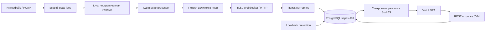
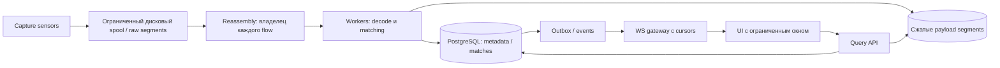

# Packmate: ревью перед крупным Attack/Defense CTF

Дата: 2026-10-10. Backend: `938031f1dedfbedabef5b049368ed5b6ba6a900a`;
frontend: `8f23d97100f11cd6671bb62aca5ce9b6a898b865`, плюс локальный патч IP-адресов.
Проверку выполнили три сабагента по направлениям capture/decoders, backend/DB/API,
frontend/deployment; основной агент сопоставил результаты с исходниками.

Обновление после ревью: реализована regex-фильтрация по IP и необходимое для неё
исправление live pattern-фильтра (пункт 9: `foundPatternsIds`). Остальные находки
ниже остаются открытыми. По просьбе пользователя работа идёт по одному этапу
с остановкой после проверки; следующий предложенный этап — зацикливание regex
по содержимому (пункт 1).

## Вывод

В текущем виде я бы не использовал Packmate как единственный анализатор трафика
на крупном соревновании. Есть подтверждённые пути зависания обработки, потери
содержимого, неверного отображения и неограниченного роста памяти. Их нужно
исправить до оценки максимальной пропускной способности. Добавление CPU/RAM или
реплик приложения само по себе эти ошибки не устраняет.

Это ревью исходников, а не сертификат производительности. Нагрузочный replay,
PostgreSQL EXPLAIN и испытание live capture не проводились. Предполагаемая цель —
инструмент команды, принимающий трафик её сервисов; центральный сбор всех команд
потребует дополнительно определить изоляцию данных, число sensors и бюджет хранения.

## Текущая архитектура

В FILE-режиме обработка идёт inline. Backend, capture, декодирование, REST,
WebSocket и фоновые задачи работают в одной JVM. PostgreSQL хранит метаданные,
payload `bytea` и совпадения: `Stream → Packet → FoundPattern`, плюс связь
`Stream ↔ Pattern`. Vue поставляется внутри JAR. Compose запускает приложение
и одну PostgreSQL на host-network. Конфигурация предполагает один `localIp`,
сервис идентифицируется портом; caches и подписчики локальны для процесса.

## Находки с высоким приоритетом

P1 означает исправление до большого соревнования; P2 — следующий обязательный
этап укрепления. Приоритет учитывает условия воспроизведения, а не измеренную частоту.
Пути ниже относительно корня репозитория; номера строк относятся к проверенной версии.

### 1. P1: обработка может зациклиться на обычном regex

`src/main/java/ru/serega6531/packmate/service/PatternMatcher.java:52–59`:
цикл вызывает `matcher.find(startPos)` и присваивает `startPos = matcher.end()`.
При пустом совпадении (`^`, `a*`) позиция не сдвигается. Для `^` каждый поиск
снова находит диапазон `[0,0)`. Live processor перестаёт сохранять последующие
потоки, очередь продолжает расти.

Исправить продвижение поиска: использовать `Matcher.find()` без ручного сброса
позиции и определить политику пустых совпадений. Ограничить стоимость regex на
недоверенном payload; один timeout вокруг Java regex не гарантирует остановку
вычисления. При необходимости использовать движок с ограниченным временем
поиска/линейной сложностью или изолированный worker.

### 2. P1: один consumer и очередь без лимита

`pcap/LivePcapWorker.java:39`, `pcap/AbstractPcapWorker.java:202`,
`service/StreamService.java:107–141` под `src/main/java/ru/serega6531/packmate/`.
`LinkedBlockingQueue<>` не ограничена практически полезным бюджетом. Единственный
обработчик синхронно декодирует поток, ищет паттерны, сохраняет его и рассылает WS.
Медленная БД, дорогой regex или клиент UI увеличивают backlog захваченных payload
в heap вплоть до OOM.

Разделить этапы, ограничить очереди по байтам и количеству элементов, добавить
spool на диск и явную политику перегрузки. Блокирование callback захвата при
полной очереди само по себе переносит потери в capture/kernel buffer. Нужны
счётчики потерь и возможность повторной обработки сохранённого сырого трафика.

### 3. P1: активные соединения не имеют лимита размера и возраста

`pcap/AbstractPcapWorker.java:180,237`, `tasks/TimeoutStreamsSaver.java:16`.
Сохраняется весь список пакетов; проверяется только idle timeout последнего
пакета. Постоянный WebSocket/UDP/keep-alive поток может расти весь раунд и
появиться в UI только после завершения/простоя. FILE-режим не запускает timeout
saver: UDP и незакрытые TCP могут копиться до EOF большого дампа.

Ввести общий budget активных flow, предел байтов на flow, максимальную длительность
сегмента и периодическое сохранение частей с общим connection ID. Для FILE
эвикция должна использовать время пакетов, а не wall clock обработки дампа.

### 4. P1: отсутствует TCP reassembly по sequence numbers

`pcap/AbstractPcapWorker.java:96`, `utils/PacketUtils.java:21`.
SEQ не учитывается: payload конкатенируется в порядке захвата. Retransmission
дублирует байты, out-of-order меняет содержимое, gaps не обозначаются. Это
влияет на поиск флагов, воспроизводимость запросов и декодирование протоколов.

Нужен двунаправленный reassembly с SYN/SEQ, retransmit/overlap policy, ограниченным
окном reorder и признаками incomplete/gap/truncated. Сохранять исходный capture
и производное представление раздельно. TLS parser также должен получать поток
байтов: сейчас `service/optimization/TlsDecryptor.java:70,275` пытается разобрать
TLS record из каждого отдельного TCP payload до объединения.

### 5. P1: HTTP pipelining теряет данные, распаковка не ограничена

`service/optimization/HttpProcessor.java:34–43,51–63`,
`service/optimization/StreamOptimizer.java:54`.
После merge парсится одно HTTP-сообщение; весь исходный блок заменяется им.
Два запроса в одном блоке теряют второй перед поиском паттернов. Декодированное
тело пишется в растущий `ByteArrayOutputStream`; аргумент `256` у
`writeDecodedTo` — размер рабочего буфера, а не лимит результата.

Потеря второго запроса подтверждена запуском собранного `HttpProcessor` через
временный Java harness: вход 87 байт с `/first` и `/second`, выход 43 байта,
`HTTP_FIRST_PRESENT=true`, `HTTP_SECOND_PRESENT=false`. Ошибочное равенство
ключей flow из раздела P2 также подтверждено исполнением `UnfinishedStream`:
разные пары endpoint имеют `equals=true` и одинаковый hash.

Разбирать все сообщения с учётом framing, сохранять необработанный остаток,
ограничить размер декодированного тела, коэффициент расширения и бюджет обработки.
Оставлять raw bytes доступными независимо от результата декодирования.

Воспроизводимый сетевой PoC находится в `poc/http_gzip_expansion.py`. Он
отправляет gzip HTTP POST на указанный host/port и позволяет задать точный
объём после распаковки. Проверочный запуск с `100MiB` передал 101 942 байта
сжатого тела при ожидаемых 104 857 600 байтах после декодирования (1028,6×).
Инструкция и ограничения: `poc/README.md`.

### 6. P1: страница пакетов может загрузить весь оставшийся поток

`repository/StreamRepository.java:21–27`, `service/StreamService.java:261`.
`LEFT JOIN FETCH p.matches` объединён с `Pageable`. При fetch join коллекции
Hibernate ограничивает результат в памяти: небольшой pageSize не ограничивает
объём прочитанных packets/payload/matches. Повторные страницы большого потока
снова выполняют дорогую загрузку. Это вывод по семантике Hibernate; SQL-трасса
на реальной PostgreSQL в этом ревью не снималась.

Сначала получать страницу ID с SQL LIMIT, затем выбранные packets и matches.
Кандидат индекса: `(stream_id,id)`. Включить
`hibernate.query.fail_on_pagination_over_collection_fetch=true` как регрессионную
защиту. Дополнительно ограничить pageSize и байты ответа на сервере.

### 7. P1: lookback и retention работают слишком крупными транзакциями

`service/StreamService.java:145–159,270,309`, `repository/StreamRepository.java:19`.
Lookback выбирает весь интервал и держит загружаемые packet graphs в одном
persistence context. Derived delete retention удаляет сущности через ORM
cascade, а не ограниченный bulk SQL. Большая история создаёт heap pressure,
длинные транзакции и конкуренцию с ingest. `docker-compose.yml:11` дополнительно
отключает cleanup по умолчанию, позволяя БД расти до заполнения диска.

Lookback: durable jobs, ограниченный executor, курсор, небольшие транзакции,
отмена и прогресс. Retention: ограниченные SQL batches с продуманным FK cascade,
затем временные партиции. Перед удалением партиции избранные потоки нужно
перенести/сохранить отдельно. Политика хранения должна включать бюджет диска.

### 8. P1: общее изменяемое состояние небезопасно для concurrency

`service/PatternService.java:39,67,139`, `service/ServicesService.java:35,76,119`:
HTTP изменяет обычные HashMap, пока capture и async job их читают/итерируют.
Возможны CME и несогласованные настройки. `service/PatternMatcher.java:19–21,141–147`
кеширует общие mutable KMP searchers; `utils/KMPStringSearcher.java:16,46,70`
содержит изменяемый `lastEnd`. Live и lookback могут портить позиции совпадений
друг друга даже после замены map на concurrent variant.

Публиковать immutable snapshots конфигурации после commit. Кешировать только
неизменяемые скомпилированные паттерны; состояние поиска создавать на операцию.
Не увеличивать число capture workers без явного владения состоянием каждого flow.

### 9. P1: live-фильтр по паттерну ломает новые события

`frontend/src/components/Sidebar.vue:206` читает `stream.foundPatterns.some`,
а `model/pojo/StreamDto.java:16` отдаёт `foundPatternsIds`. Воспроизведено запуском
реального метода компонента в Node: корректный DTO с `foundPatternsIds:[1]`
вызывает TypeError; новый поток при активном pattern-фильтре не появляется.

Использовать `foundPatternsIds.includes(Number(route.query.pattern))` и общий
контракт REST/WS с проверкой события активного фильтра.

### 10. P1: UI не ограничивает историю и смешивает ответы разных запросов

`frontend/src/components/Sidebar.vue:35,210`: каждый NEW_STREAM добавляется
в неограниченный массив, весь массив рендерится. При условных 100 events/s за час
это 360 000 элементов, если вкладка успевает принять события. Это арифметический
пример роста, не результат нагрузочного теста.

`frontend/src/views/ContentStream.vue:62–77`: запоздалый ответ A добавляется
в массив после перехода к B. Воспроизведено вызовом исходного метода с отложенным
HTTP-ответом. Аналогичная гонка есть у смены фильтра sidebar.

Ограничить окно истории, виртуализировать списки, пакетировать live updates.
Отменять запросы и проверять generation/request key до изменения данных и
состояния infinite loader. Виртуализация без ограничения массива не решает память.

### 11. P1 при доступности из игровой сети: небезопасные значения запуска

`docker-compose.yml:9–10,20`, `docker/Dockerfile_app:26`: известный fallback
`BinaryBears/123456`, host-network и bind `0.0.0.0`. Если UI-порт достижим
противником и пароль не переопределён, доступны захваченные данные и управление.
Это условный риск конфигурации, а не утверждение о доступности данного компьютера.

Сделать web password обязательным, отделить management network/VPN и capture
interface, настроить TLS для доступа. `configuration/SecurityConfiguration.java:60`
также пишет введённый пароль при ошибке входа — убрать его из логов.

## Дополнительные исправления P2

| Проблема | Место | Что изменить |
|---|---|---|
| Ключ flow независимо переставляет IP и порты: `A:80→B:50000` равен `A:50000→B:80` | `model/pojo/UnfinishedStream.java:21` | Сравнивать пары `(IP,port)` целиком, затем протокол; выделять новые поколения TCP-соединений |
| Shutdown закрывает pcap, но не дренирует очередь и не сохраняет активные потоки | `pcap/LivePcapWorker.java:63` | Остановить producer, drain consumer, flush flows, завершить executors до закрытия БД |
| HEX искажает байты: `FF 80 00` превращается в `FD FD 00` | `frontend/src/components/Packet.vue`, computed `hexdata`, `atou`, `hexdump` | Строить HEX из Uint8Array без UTF-8 преобразования; дефект воспроизведён в Node |
| WS не имеет восстановления пропущенных событий | `service/SubscriptionService.java:53–59`, `frontend/src/App.vue:62` | Отдельная очередь на сессию, последовательная отправка, лимиты, cursor/resync при reconnect/overflow |
| Lookback продвигает checkpoint до выполнения, FINISH уходит до commit | `service/PatternService.java:153–158`, `service/StreamService.java:159` | Durable job/checkpoint после успешного чанка, after-commit/outbox, идемпотентность повторов |
| Lookback не применяет ограничение паттерна по сервису | `service/StreamService.java:148,211` | Одинаковая фильтрация сервиса для live и historical поиска |
| Список streams платит за count и lazy N+1; индексы не соответствуют фильтрам | `service/StreamService.java:302`, `configuration/ApplicationConfiguration.java:62`, `model/Stream.java:33` | Slice/limit+1, projections/batch fetch; проверить индексы service+id, timestamps, favorite через EXPLAIN |
| Minute counters обновляются и очищаются без синхронизации | `service/CountingService.java:20–46` | Атомарный snapshot/reset; раздельные captured/persisted/ignored/dropped counters |
| Размер страницы не ограничен | `model/pojo/PacketPagination.java:12`, `model/pojo/StreamPagination.java:13` | Validation min/max, предел байтов ответа и времени запроса |
| Публикация Docker образа не требует Java test | `docker/Dockerfile_app:10`, `.gitlab-ci.yml:20` | Обязательный test gate и frontend lint/build; npm ci, фиксированные версии образов |

Пути Java в таблице находятся под `src/main/java/ru/serega6531/packmate/`.
CSRF отключён при browser Basic auth (`SecurityConfiguration.java:36`):
пересмотреть защиту изменяющих состояние endpoints; браузерная эксплуатация
в рамках ревью не проверялась. У приложения нет отдельного healthcheck и
использования pcap drop statistics; лог executor раз в минуту не определяет
сохранность захвата. Поддержка RSA TLS в коде не означает поддержку расшифровки
ECDHE/TLS 1.3 без session secrets.

## Предлагаемая архитектура развития

Сначала эти границы можно реализовать в одном развёртывании с отдельными
очередями и worker pools. Отдельные сервисы и общая шина нужны после измерений.
Сборщик должен владеть всем состоянием конкретного соединения; распределение
делать по стабильному ключу `(sensor, endpoint A, endpoint B, protocol)`,
с учётом направления и поколения соединения. Shared mutable maps нельзя просто
обслуживать несколькими потоками.

Для нескольких sensors ввести `sensorId`, самостоятельный `serviceId`,
endpoint host/IP+port+protocol, capture timestamps и признаки неполноты.
Сырые данные должны иметь retention и ссылку из метаданных. Вынос payload
из PostgreSQL рассматривать по измеренному IO/объёму; он усложняет атомарность,
удаление, доступ к данным и обработку orphan segments. Kafka/ClickHouse не
обязательны на первом этапе.

## Порядок работ и критерии готовности

1. **Корректность и остановка зависаний.** Исправить regex, KMP concurrency,
   endpoint equality, HTTP pipelining, frontend filter/races/HEX. Добавить
   проверки на retransmission/reorder/gaps и корректный TCP reassembly.
   Acceptance: контрольные байты/флаги воспроизводятся без молчаливого искажения.
2. **Ограниченные ресурсы и восстановление.** Бюджеты очередей/flow/decode/UI,
   сохранение частей долгих соединений, spool, graceful shutdown, WS resync.
   Acceptance: искусственное замедление БД/браузера не ведёт к бесконечному heap;
   пропуски явно измеряются, backlog восстанавливается из доступного spool.
3. **БД и фоновые задачи.** Двухэтапная пагинация, bounded lookback и retention,
   индексы по EXPLAIN, durable checkpoints, отдельно сохранённые favorites.
   Acceptance: запрос одной страницы ограничен объёмом страницы, а не историей;
   фоновые задачи не исчерпывают DB pool и память ingest.
4. **Эксплуатация.** Обязательные credentials, management-доступ, CI gates,
   метрики и alerting, проверяемый restart/recovery, управление версией схемы
   через миграции вместо единственного `ddl-auto=update`.
5. **Измерение и масштабирование.** PCAP replay на целевом оборудовании с
   реальным распределением packets/s, bytes/s, flows/s и размеров flow.
   Проверить ожидаемый пик и запас, например 2×, плюс длительный прогон на
   продолжительность соревнования. Только после этого обещать конкретный масштаб.

Набор нагрузочных сценариев: короткие TCP, длительные TCP/UDP, retransmit/reorder,
HTTP pipelining и сжатие, TLS segmentation, крупные payload, частые regex matches;
одновременно несколько операторов, lookback и retention. Отдельно проверять
медленный WS-клиент, reconnect, замедление/недоступность БД, перезапуск процесса,
исчерпание бюджета spool и диска. Сравнивать входной manifest пакетов/флагов
с сохранёнными данными, включая корректное устранение retransmission.

Измерять capture/kernel drops, accepted/persisted/ignored/truncated counts,
queue bytes и oldest age, active flow bytes, decode/match время, DB commit
p95/p99, capture→searchable и capture→UI lag, heap/RSS/GC, disk throughput,
retention duration, API p95/p99, browser heap/DOM. Пороговые значения согласовать
с фактическим объёмом и задачами команды. Для ориентира бюджета: непрерывный
1 Gbit/s — около 450 GB за час до сжатия и накладных расходов хранения.

## Границы текущих изменений

В этой рабочей копии реализован запрос на IP-адреса пакетов и добавлены проверки
их сохранения при merge/DTO mapping, включая IPv6 и старые записи. Рекомендации
ревью выше являются планом доработок; архитектура по ним ещё не переписана.
Инструкция по патчу: [IP_ADDRESSES.md](IP_ADDRESSES.md).

Проверки рабочей копии: backend `bootJar` собран; все 5 новых тестов IP прошли
при первом прогоне. Полный прогон первоначально дал 12/13: существующий TLS-тест
падает на CRLF в PEM (`Illegal base64 character d`), потому что `RsaKeysHolder`
удаляет только LF. После нормализации **копии** fixture в `build/resources/test`
на LF и запуска `test -x processTestResources` прошли 13/13. Исходник PEM и TLS
loader не изменялись; Windows-совместимость loader требует отдельного исправления.
Frontend lint изменённого компонента и production build прошли; сборщик
предупреждает о размере vendor bundle. Live capture, миграция схемы и полный
браузерный сценарий с работающим backend не запускались.
